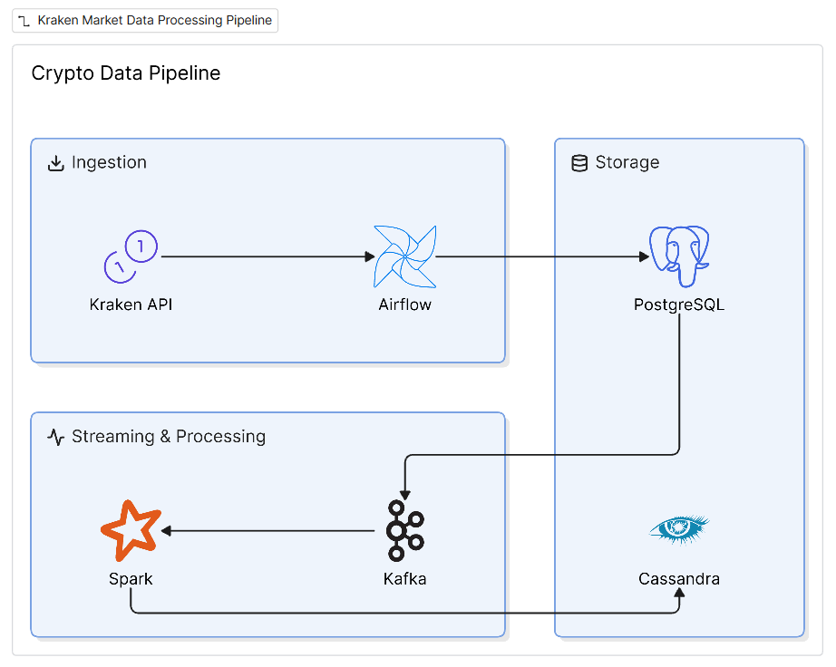

# Crypto Market Data Pipeline (Kraken)

A real-time data pipeline that pulls live crypto trades from Kraken, streams them through Kafka, crunches them with Spark, and serves per-minute stats from Cassandra.
> **Kraken API → Airflow → PostgreSQL → Kafka (Avro + Schema Registry) → Spark Structured Streaming → Cassandra → REST API**. 

## Architectural Overview



| Step | Tool | What it does |
|---|---|---|
| 1 | Airflow | Fetches and validates trades every minute |
| 2 | PostgreSQL | Stores the raw trades |
| 3 | Kafka | Streams trades out of Postgres |
| 4 | Spark | Computes 1-minute average price, VWAP, volatility, volume |
| 5 | Cassandra | Serves the results for dashboards and APIs |

**Why it's reliable:** re-running or restarting never creates duplicates. Postgres ignores repeated trade IDs, Spark drops duplicate events, and Cassandra overwrites rows by key.

## Before you start

- Docker and Docker Compose v2, with at least 8 GB of RAM available to Docker
- Internet access (Kraken's public API needs no API key)
- Optional for local development: Python 3.11 and [uv](https://docs.astral.sh/uv/)

Check Kraken's [API docs](https://docs.kraken.com/) for current rate limits and regional availability.

## Project layout

```text
crypto-pipeline/
├── docker-compose.yml
├── .env.example
├── .gitignore
├── README.md
├── requirements.txt
├── sql/
│   └── postgres_init.sql
├── cassandra/
│   └── init.cql
├── airflow/
│   └── dags/
│       └── kraken_ingest_dag.py
├── src/
│   ├── kraken_client.py
│   ├── validation.py
│   ├── db.py
│   └── publisher.py
├── spark/
│   └── trade_aggregates.py
├── kafka/
│   └── topics.sh
├── tests/
│   ├── test_validation.py
│   └── test_client.py
└── docs/
    └── architecture.png
```

## Quick start

**1. Configure**

```bash
cp .env.example .env     # then set POSTGRES_PASSWORD
```

**2. Start the databases and Kafka**

```bash
docker compose up -d postgres kafka cassandra
```

**3. Create the Cassandra table** (wait 1 to 2 minutes after step 2 if it errors)

```bash
docker compose exec cassandra cqlsh -f /init.cql
```

**4. Create the Kafka topic**

```bash
docker compose exec kafka /opt/kafka/bin/kafka-topics.sh \
  --bootstrap-server kafka:9092 --create --if-not-exists \
  --topic kraken.trades.v1 --partitions 3 --replication-factor 1
```

**5. Start Spark, then Airflow**

```bash
docker compose up -d spark
docker compose up -d --build airflow
docker compose exec airflow cat /opt/airflow/standalone_admin_password.txt
```

**6. Turn it on.** Open <http://localhost:8088>, log in as `admin`, and unpause the `kraken_ingest` DAG.

After about 5 minutes you should see results:

```bash
docker compose exec cassandra cqlsh -e "SELECT * FROM crypto.trade_stats_1m LIMIT 5"
```

## Is it working?

| Check | Where |
|---|---|
| DAG runs are green | <http://localhost:8088> |
| Messages are flowing | <http://localhost:8080> (Kafka UI) |
| Raw trades are arriving | `SELECT count(*) FROM trades;` in Postgres |
| Results are being served | The `cqlsh` query above |

**Accuracy check:** pick a *finished* minute (not the current one) and compare both stores. The counts and volumes must match.

```sql
-- PostgreSQL
SELECT count(*), sum(volume) FROM trades
WHERE symbol = 'XBTUSD'
  AND trade_ts >= '2026-11-02 10:00+00' AND trade_ts < '2026-11-02 10:01+00';

-- Cassandra
SELECT trade_count, total_volume FROM crypto.trade_stats_1m
WHERE symbol = 'XBTUSD' AND day = '2026-11-02'
  AND window_start = '2026-11-02 10:00:00+0000';
```

## Restart test

Proves nothing is lost or duplicated:

1. Let the pipeline run for 5 minutes.
2. `docker compose stop spark`, wait 3 minutes, then `docker compose start spark`.
3. Run the accuracy check for a minute that spans the outage. The numbers should still match.
4. Repeat with Kafka, Postgres and Cassandra, and save your results in `docs/failure-tests.md`.

## Configuration

Everything is set in `.env` (never commit it; commit only `.env.example`).

| Variable | Purpose | Example |
|---|---|---|
| `KRAKEN_PAIRS` | Pairs to ingest | `XBTUSD,ETHUSD` |
| `POSTGRES_USER` / `POSTGRES_PASSWORD` / `POSTGRES_DB` | Database login | `admin` / `change_me` / `crypto_pipeline` |
| `KAFKA_BOOTSTRAP_SERVERS` | Broker address | `kafka:9092` |
| `KAFKA_TOPIC_TRADES` | Trades topic | `kraken.trades.v1` |
| `CASSANDRA_HOST` / `CASSANDRA_KEYSPACE` | Serving database | `cassandra` / `crypto` |

## Local development

```bash
uv sync                  # install dependencies
uv run pytest            # run tests
uv run ruff check .      # lint
```

Airflow runs inside its own Docker image, so it is not a project dependency. To refresh that image's packages after changing dependencies:

```bash
uv export --no-dev --no-hashes -o airflow/requirements.txt
docker compose up -d --build airflow
```

## Troubleshooting

| Problem | Fix |
|---|---|
| Spark exits at startup | Cassandra wasn't ready. Run step 3, then `docker compose restart spark` |
| Cassandra table is empty | Check Kafka UI for messages, and Airflow for failed runs |
| No data from Kraken | Test with `curl "https://api.kraken.com/0/public/Trades?pair=XBTUSD&count=3"` |
| DAG import error | Run `docker compose exec airflow airflow dags list-import-errors` |
| Containers crash | Give Docker at least 8 GB of RAM |

Handy commands:

```bash
docker compose ps                  # service status
docker compose logs -f <service>   # live logs
docker compose down                # stop, keep data
docker compose down -v             # stop and delete all data
```

## Security

- Secrets live only in `.env`, which is git-ignored.
- Run `git status` before your first push to confirm `.env` isn't tracked.
- If a secret is ever committed, rotate it. Deleting the file doesn't erase git history.

## License

This project is open-source and licensed under the terms of the [MIT LICENSE](MIT).
