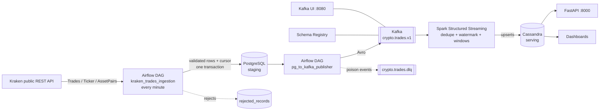

# Kraken Crypto Market Data Pipeline

Batch + streaming data pipeline: **Kraken API → Airflow → PostgreSQL → Kafka (Avro + Schema Registry) → Spark Structured Streaming → Cassandra → REST API**. Fully containerised and reproducible from this repository.

## Architecture



| Layer | Tool | Role |
|---|---|---|
| Ingestion | Airflow | Polls Kraken every minute with a persisted `since` cursor; validates; stores raw data |
| Staging | PostgreSQL | `symbols`, `trades`, `prices`, `ingestion_state`, `rejected_records` |
| Streaming | Kafka, Schema Registry, Kafka UI | Avro events, BACKWARD compatibility, monitoring |
| Processing | Spark 3.5 | 1m/1h windows: avg, min/max, VWAP, volume, trade count, volatility; anomaly rules |
| Serving | Cassandra | Tables designed per query; idempotent upserts |
| Access | FastAPI | Read-only query API over Cassandra |

## Repository layout

```text
.
├── .env.example  .gitignore  .dockerignore  docker-compose.yml  Makefile  pytest.ini
├── airflow/    Dockerfile, requirements.txt, dags/{kraken_ingestion_dag,pg_to_kafka_dag}.py
├── src/        kraken_client, validators, db, ingestion, publisher, quality, config
├── sql/        00_create_airflow_db.sql, 01_postgres_schema.sql, 02_cassandra_schema.cql
├── kafka/      create_topics.sh, schemas/trade_event.avsc
├── spark/      Dockerfile, jobs/stream_trades.py
├── api/        FastAPI app over Cassandra
├── scripts/    verify_restart.py (Postgres vs Cassandra reconciliation)
├── tests/      unit tests (validators, client, publisher mapping)
└── docs/       restart-test.md
```

## Setup

**Prerequisites:** Docker Engine/Desktop with Compose v2, ~12 GB RAM free for the full stack (Kafka, Cassandra, Spark, Airflow), internet access (Kraken API, Maven Central for Spark packages on first start).

1. **Create your environment file**
   ```bash
   cp .env.example .env
   python3 -c "from cryptography.fernet import Fernet; print(Fernet.generate_key().decode())"   # -> AIRFLOW_FERNET_KEY
   python3 -c "import secrets; print(secrets.token_hex(32))"                                     # -> AIRFLOW_SECRET_KEY
   ```
   Edit `.env`: set `POSTGRES_PASSWORD` (URL-safe characters only), `AIRFLOW_ADMIN_PASSWORD`, and paste the two generated keys. If you lack the `cryptography` package, `pip install cryptography` first.
2. **Kraken credentials (optional).** The pipeline only uses **public** endpoints, which need no key. If you want keys in `.env` anyway, create them at <https://pro.kraken.com/app/settings/api> with *no* trading or withdrawal permission; the secret is shown once. Never commit `.env`.
3. **Start everything**
   ```bash
   docker compose up -d --build        # or: make up
   docker compose ps                   # kafka-init and cassandra-init exit 0; the rest stay Up
   ```
   First start takes several minutes (image pulls, Cassandra warm-up, Spark downloads connector jars into the `ivycache` volume).
4. **Open the UIs** (bound to localhost only)

   | Service | URL |
   |---|---|
   | Airflow | <http://localhost:8083> (`AIRFLOW_ADMIN_USER` / `AIRFLOW_ADMIN_PASSWORD`) |
   | Kafka UI | <http://localhost:8080> |
   | Schema Registry | <http://localhost:8081/subjects> |
   | Spark master / job UI | <http://localhost:8082> / <http://localhost:4040> |
   | API docs | <http://localhost:8000/docs> |

   Both DAGs are unpaused at creation and start running within a minute.

## Verify each stage

```bash
# 1. Ingestion -> Postgres
docker compose exec postgres psql -U admin -d crypto_pipeline -c \
  "SELECT symbol, count(*), max(trade_ts) FROM trades GROUP BY 1;"
# 2. Publisher -> Kafka (backlog should trend to 0; messages visible in Kafka UI)
docker compose exec postgres psql -U admin -d crypto_pipeline -c \
  "SELECT count(*) FILTER (WHERE published_at IS NULL) AS unpublished, count(*) AS total FROM trades;"
curl -s http://localhost:8081/subjects
# 3. Spark -> Cassandra
docker compose exec cassandra cqlsh -e "SELECT * FROM crypto.latest_price;"
docker compose exec cassandra cqlsh -e \
  "SELECT window_start, avg_price, vwap, volume, trade_count, volatility FROM crypto.trade_agg_1m WHERE symbol='BTC/USD' AND day=toDate(now()) LIMIT 5;"
# 4. API
curl -s http://localhost:8000/prices/BTC-USD/latest
curl -s "http://localhost:8000/aggregates/BTC-USD?start=2026-10-25T00:00:00Z&end=2026-10-25T06:00:00Z&interval=1m"
```
(Replace `admin` / `crypto_pipeline` with your `.env` values; adjust dates.)

## Design notes

- **Idempotent ingestion.** `UNIQUE (symbol, trade_id)` + `ON CONFLICT DO NOTHING`; the Kraken `last` cursor is committed in the *same transaction* as the rows, so a crashed run is simply repeated. First run (no cursor) takes Kraken's most recent trades, not the full history.
- **Rate limiting.** One shared client enforces spacing between calls (`KRAKEN_MIN_INTERVAL_SECONDS`), retries with backoff on rate-limit/network errors; tasks run sequentially.
- **At-least-once Kafka delivery.** Rows are marked `published_at` only after broker acknowledgement (`acks=all`, idempotent producer). Unserialisable rows go to `crypto.trades.dlq` + `rejected_records`.
- **Effectively-once results.** Spark drops duplicate `event_id`s within the watermark, and Cassandra primary keys include the window start, so replays overwrite identical rows.
- **Watermark.** `WATERMARK` (default 10 min) trades completeness against state size. Events later than that behind the newest event time are dropped by design.
- **Schema evolution.** Subject compatibility is BACKWARD; add fields with defaults. Spark decodes with the schema file in `kafka/schemas/`, so update it (and restart Spark) when you evolve the schema.
- **Volatility** = sample standard deviation of trade prices in the window (0 for a single trade).
- **Anomalies** (`crypto.anomalies`): `PRICE_RANGE` (intra-minute high-low range above `ANOMALY_RANGE_PCT`) and `VOLUME_SPIKE` (volume z-score above `ANOMALY_VOLUME_Z` against the prior 30 minutes). Rows are keyed by window, so they are idempotent; a window re-evaluated as it fills can leave a stale flag.
- **Scalability.** Add Kafka partitions (key = symbol), Spark workers, Cassandra nodes (use `NetworkTopologyStrategy`, RF=3). Replication factors of 1 here are for local development only.

## Data-quality checks (Airflow, `pg_to_kafka_publisher`)

`check_freshness` (no new trades for `QUALITY_MAX_STALENESS_MIN`), `check_backlog` (unpublished rows above `QUALITY_MAX_BACKLOG`), `check_reject_rate` (above `QUALITY_MAX_REJECT_RATE`). A breach fails the task so it shows red in Airflow; wire Airflow email/Slack callbacks for real alerting.

## Tests and restart proof

```bash
make test            # unit tests (no Docker needed)
make verify          # Postgres vs Cassandra reconciliation for closed minutes
```
Follow `docs/restart-test.md` for the controlled-restart procedure and record the output there.

## Failure drills

| Drill | Command | Expected |
|---|---|---|
| Spark crash | `docker compose stop spark-streaming && sleep 120 && docker compose start spark-streaming` | Catches up from checkpoint; `make verify` passes |
| Kafka outage | `docker compose stop kafka` | Publish tasks fail/retry, rows stay unpublished, backlog check alerts, no data loss |
| Cassandra outage | `docker compose stop cassandra` | Spark batches fail and are replayed after restart |
| Bad data | `pytest tests/test_validators.py` (malformed rows) | Rejected with a reason; stored in `rejected_records` at runtime, never silently dropped |
| Kraken unreachable | Block egress / set a bad `KRAKEN_BASE_URL` | Retries, then task failure; cursor unchanged |

## Troubleshooting

- `airflow-init` fails with a Fernet error: `AIRFLOW_FERNET_KEY` is empty or invalid.
- Postgres changes not applied: init scripts run only on an empty volume; `make reset` (destroys data).
- Spark stuck on `Ivy`/package download: check internet access from the container; first start is slow.
- Spark job cannot reach Kafka from the host: use `localhost:29092` (external listener); inside Docker use `kafka:9092`.
- Spark cannot decode events after a schema change: update `kafka/schemas/trade_event.avsc` and restart `spark-streaming`.
- Pair names: REST uses `XBTUSD`; downstream symbols are normalised (`BTC/USD`). API paths use a dash: `BTC-USD`.
- Verify current Kraken rate limits and terms at <https://docs.kraken.com> before running at scale.

## Security

All secrets live in `.env` (git-ignored, excluded from Docker contexts). `.env.example` contains placeholders only. Service ports are bound to `127.0.0.1`. Use read-only Kraken keys, or none.
